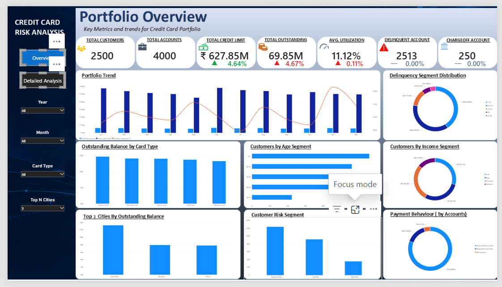

# 💳 Credit Card Portfolio & Risk Analytics

<p align="center">
  
  
  
  
  
</p>

<p align="center">
  <b>Analysing customer behaviour, credit utilization, payment patterns, and portfolio risk using SQL Server, Python, and Power BI.</b>
</p>

---

## 📌 Project Overview

Credit card portfolio management requires a clear understanding of customer characteristics, account activity, repayment behaviour, and outstanding balances. This project analyses a credit card portfolio using SQL Server, Python, and Power BI to identify patterns that can support portfolio monitoring and risk assessment.

The project combines SQL-based data exploration, Python statistical analysis and visualizations, and an interactive Power BI dashboard. The analysis covers customer demographics, credit scores, card products, utilization levels, payment behaviour, outstanding balances, delinquency indicators, and charge-off flags.

### 🎯 Project Objectives

- Analyse customer demographics and account portfolio characteristics.
- Examine credit score, salary, and age distributions.
- Evaluate credit utilization and outstanding balances.
- Investigate payment behaviour and delinquency indicators.
- Compare portfolio metrics across card products and customer segments.
- Build an interactive Power BI dashboard for portfolio monitoring.
- Translate analytical findings into practical business observations.

## 🛠️ Tools & Technologies

| Tool | Purpose |
|---|---|
| SQL Server | Data exploration, querying, aggregations, and business analysis |
| Python | Statistical analysis and exploratory data analysis |
| Pandas | Data manipulation and analysis |
| Matplotlib | Data visualization |
| Seaborn | Statistical charts and distribution analysis |
| Jupyter Notebook | Interactive Python analysis |
| Power BI | Interactive dashboard development and portfolio monitoring |
| DAX | KPI calculations, account-level measures, ranking, and dynamic Top N filtering |

## 📊 Portfolio Snapshot

The dataset contains customer, product, and account statement information.

| Metric | Result |
|---|---:|
| Total Customers | 2,500 |
| Total Accounts | 4,000 |
| Account Statement Records | 48,000 |
| Card Product Categories | 5 |
| Average Credit Utilization | 30.41% |
| Unpaid Statement Records | 1,453 |
| Records with DPD Above 90 Days | 3,259 |
| Charge-Off-Flagged Records | 3,259 |

These figures provide an overview of the dataset analysed. Customer counts, account counts, and statement-level counts represent different levels of the portfolio and should not be treated as interchangeable.

## 📈 Key Statistical Findings

### 1. Credit Score Distribution

| Credit Score Band | Share |
|---|---:|
| 700–800 | 28.60% |
| 800+ | 28.52% |
| 600–700 | 27.88% |
| Below 600 | 15.00% |

**Business observation:** Customers in the 700-and-above credit score bands represent the largest combined share of the portfolio. The 15% share below 600 identifies a segment worth examining more closely for repayment behaviour and credit exposure.

### 2. Customer Demographics

#### Age Distribution

| Age Group | Share |
|---|---:|
| 55+ | 24.44% |
| 46–55 | 23.09% |
| 26–35 | 22.56% |
| 36–45 | 20.11% |
| 18–25 | 9.81% |

#### Salary Segmentation

| Salary Segment | Share |
|---|---:|
| High | 37.28% |
| Premium | 35.40% |
| Medium | 18.12% |
| Low | 9.20% |

**Business observation:** Customers aged 46 and above represent substantial portions of the analysed customer base. High and Premium salary categories also account for a large combined share. Comparing these segments with utilization, outstanding balances, and repayment behaviour could reveal differences in portfolio exposure.

### 3. Payment Behaviour

| Payment Behaviour Category | Share |
|---|---:|
| Above Minimum Due | 80.99% |
| Below Minimum Due | 15.39% |
| No Payment | 3.63% |

**Business observation:** Most records fall into the Above Minimum Due category. The Below Minimum Due and No Payment groups warrant closer examination because repayment shortfalls can indicate potential financial stress.

*Note: These percentages are based on the categories and calculations used in the analysis. Confirm the underlying definitions and denominator before interpreting them as unique-customer percentages.*

### 4. Customer Segment Distribution

| Customer Segment | Share |
|---|---:|
| Revolver | 80.99% |
| Delinquent | 15.39% |
| No Payment | 3.03% |
| Transactor | 0.60% |

**Business observation:** The Revolver segment dominates the reported distribution. The delinquent and no-payment segments may require additional analysis of outstanding balances, utilization, and payment history.

*Note: Validate the segment definitions and category totals against the source data before using these values for business decisions.*

### 5. Credit Utilization Analysis

| Utilization Band | Share |
|---|---:|
| 0–10% | 24.63% |
| 10–30% | 41.64% |
| 30–50% | 15.95% |
| 50–75% | 8.84% |
| 75–90% | 2.50% |
| Above 90% | 5.82% |
| No Usage | 0.62% |

**Business observation:** The 10–30% utilization band is the largest category, accounting for 41.64% of the reported distribution. Although the above-90% utilization group is smaller, it is worth investigating because high utilization can indicate limited available credit.

### 6. Outstanding Balance Statistics

| Statistical Measure | Outstanding Balance |
|---|---:|
| Mean | 32,813.54 |
| Median | 25,940.34 |
| Standard Deviation | 23,741.03 |
| Minimum | 0.00 |
| First Quartile (Q1) | 16,080.72 |
| Third Quartile (Q3) | 43,070.54 |
| Maximum | 127,453.00 |

**Business observation:** The mean outstanding balance is higher than the median, suggesting that relatively high balances may be pulling the average upward. The standard deviation also indicates considerable variation in account balances.

The currency unit should be confirmed from the source data before presenting these values as a specific currency.

### 7. Charge-Off Flag Analysis

| Charge-Off Flag | Record Count | Average Balance | Median Balance |
|---|---:|---:|---:|
| 0 | 44,741 | 32,776.34 | 25,920.00 |
| 1 | 3,259 | 33,324.31 | 26,272.87 |

**Business observation:** Flagged records have a somewhat higher average and median outstanding balance than unflagged records. These differences alone do not establish that higher balances cause charge-offs or that every flagged record represents a confirmed loss.

The flag's business definition, timing, and relationship to delinquency should be validated before drawing risk conclusions.

## 💳 Card Product Analysis

### Card Product Comparison

| Card Product | Interest Rate | Annual Fee |
|---|---:|---:|
| Business Card | 30% | 1,499 |
| Classic | 32% | 499 |
| Gold | 34% | 999 |
| Platinum | 36% | 1,999 |
| Student | 28% | 299 |

Each card product represents 20% of the reported product distribution.

### Rewards Distribution

| Rewards Type | Share |
|---|---:|
| Cashback | 40% |
| Reward Points | 20% |
| Travel | 20% |
| Air Miles | 20% |

**Business observation:** Cashback is the most common rewards category in the reported distribution. Comparing utilization, outstanding balances, payment behaviour, and delinquency indicators across card products could help identify differences in portfolio patterns.

## 🔍 Analytical Workflow

### SQL Server

SQL Server was used to explore and analyse the customer, product, and account statement datasets.

- Explored the source tables and their columns.
- Reviewed portfolio size and category distributions.
- Calculated summary metrics and aggregations.
- Analysed outstanding balances and credit utilization.
- Examined payment behaviour and risk indicators.
- Used SQL queries to investigate delinquency and charge-off records.
- Prepared query-based findings for Python analysis and Power BI reporting.

### Python

Python was used to perform exploratory data analysis, descriptive statistics, and visual analysis.

- Loaded and inspected datasets using Pandas.
- Examined dataset dimensions, column information, and data distributions.
- Calculated descriptive statistics for numerical variables.
- Analysed customer demographics and credit score segments.
- Investigated utilization, payment behaviour, and outstanding balances.
- Compared portfolio characteristics using Matplotlib and Seaborn visualizations.
- Interpreted the results from a business perspective.

### Power BI

Power BI was used to turn the analysed data into an interactive portfolio monitoring dashboard.

- Created DAX measures for customer, account, credit limit, outstanding balance, and utilization KPIs.
- Analysed delinquent and charge-off accounts using account-level calculations.
- Used the latest account snapshot where appropriate to avoid repeatedly counting historical snapshots in account-level metrics.
- Ranked cities by total outstanding balance.
- Created a What-if parameter to dynamically select the Top N cities displayed in a bar chart.
- Designed interactive visuals to make portfolio exposure and risk indicators easier to explore.

## 📊 Power BI Dashboard

The Power BI dashboard complements the SQL and Python analysis by presenting key portfolio metrics and risk indicators in an interactive format.

### Key Performance Indicators

| KPI | Purpose |
|---|---|
| Total Customers | Measures the number of customers in the portfolio |
| Total Accounts | Measures distinct credit card accounts |
| Total Credit Limit | Summarizes credit limits for the selected account snapshots |
| Total Outstanding | Measures outstanding balances for the selected account snapshots |
| Average Utilization | Shows outstanding balances relative to credit limits |
| Delinquent Accounts | Counts distinct accounts with days past due greater than zero |
| Charge-Off Accounts | Counts distinct accounts flagged for charge-off |

The dashboard uses DAX measures to calculate these KPIs dynamically based on the report's filter context.

### DAX Measures and Analysis

The Power BI model includes measures for:

- Total Customers
- Total Accounts
- Total Credit Limit
- Total Outstanding
- Average Utilization
- Delinquent Accounts
- Charge-Off Accounts
- Monthly Outstanding Balance
- Previous Month Outstanding
- Month-over-Month Variance
- Month-over-Month Variance Percentage
- City Rank
- City Rank Filter

The Month-over-Month measures compare outstanding balances across reporting periods. The City Rank measure ranks cities by outstanding balance, while the dynamic Top N filter lets users choose how many ranked cities appear in the bar chart.

### Interactive Dashboard Features

- KPI cards for high-level portfolio monitoring.
- Analysis of outstanding balances and credit utilization.
- Delinquency and charge-off monitoring.
- City-level ranking based on outstanding balances.
- A dynamic Top N selection using a What-if parameter.
- Interactive filtering to explore portfolio data by available categories.

### Power BI Dashboard Preview

The dashboard screenshot is available in the `PowerBI/` folder of this repository.



*The screenshot presents the dashboard's visual layout. The interactive Power BI report file is kept private.*

## 💡 Business Takeaways

1. **Monitor high utilization:** Review accounts in the above-90% utilization band alongside repayment behaviour and available credit.
2. **Investigate repayment shortfalls:** Examine accounts with below-minimum payments or no payments to identify potential early-warning signals.
3. **Segment portfolio exposure:** Compare outstanding balances and risk indicators across credit score, age, salary, and card product categories.
4. **Review flagged accounts carefully:** Validate charge-off and delinquency definitions before treating the indicators as confirmed credit losses.
5. **Monitor outstanding balances:** Use summary statistics and city-level comparisons to identify where balances are concentrated.
6. **Combine multiple indicators:** Customer profiles, balances, utilization, and payment history provide more context than any single metric.
7. **Use interactive reporting:** Power BI enables users to explore portfolio metrics and focus on selected cities through dynamic Top N filtering.

These are descriptive observations, not predictions of default or evidence of causation.

## 📁 Repository Structure

```text
credit-card-portfolio-risk-analytics/
│
├── SQL/
│   └── credit_card_risk_analysis.sql
│
├── Python/
│   └── CreditRisk_Analysis.ipynb
│
├── PowerBI/
│   └── dashboard.png
│
└── README.md
```

The repository contains the SQL scripts, Python notebook, and a screenshot of the Power BI dashboard. The `.pbix` file is kept private and is not included in the public repository.

## 🚀 Future Enhancements

- Expand the Power BI dashboard with additional portfolio and risk analysis pages.
- Add more comparisons across customer segments and card products.
- Improve delinquency monitoring using validated business definitions.
- Add further drill-downs for outstanding balances and utilization.
- Explore predictive credit risk modelling after validating the dataset and target definitions.
- Document the business meaning and calculation logic of key risk indicators.

## ⚠️ Notes & Limitations

- Results reflect the dataset and calculations used in this project.
- Record-level percentages may differ from unique-customer percentages.
- The identical reported counts for DPD above 90 days and charge-off-flagged records (3,259 each) should be investigated. Equal counts do not establish that these are the same records.
- The charge-off flag should be validated against its source definition.
- Account-level Power BI metrics use the latest account snapshot where appropriate; results may differ from statement-level statistics.
- Delinquent and charge-off account counts depend on the DAX definitions and account snapshot logic.
- Currency units and business definitions should be confirmed before using the findings in formal reporting.
- Descriptive statistics identify patterns but do not establish causation or predict future credit losses.
- The Power BI screenshot is shared for portfolio presentation; the `.pbix` file is kept private.

## 👩‍💻 Project Focus

This project demonstrates practical application of SQL querying, Python-based exploratory data analysis, descriptive statistics, data visualization, DAX measures, and interactive Power BI reporting in a credit card portfolio analytics context.

---

<p align="center">
  <b>Credit Card Portfolio & Risk Analytics</b><br/>
  SQL Server · Python · Pandas · Power BI · DAX
</p>
